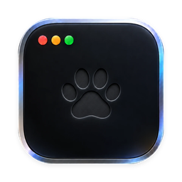

  

  
  

<h1 align="center">Agentic Terminal Multiplexer</h1>

  

## Main features

- **Many agents, one window.** Run Claude Code, Codex CLI, Gemini CLI, Copilot CLI, Cursor Agent, opencode, Aider, Qwen Code and Goose side by side, in tabs, split panes and tab groups you can fold and drag.
- **Paw Agent.** A built-in agent on your own models: Anthropic, GitHub Copilot, ChatGPT, OpenRouter, Ollama or any OpenAI-compatible provider.
- **Tasks.** Describe a goal; a planner splits it into steps for your agents, runs them in order or side by side, and shows the plan as a graph (or in 3D). Steps that need you wait for your approval.
- **A shell in every tab.** Run commands next to the agent in your own shell, then pass their output to the agent with one click.
- **Keeps running.** Agents run in a background process with a menu bar icon, so closing the window doesn't stop their work.
- **Sessions.** Each session's conversation, scripts and files are kept in `~/.paw`; reopen past sessions and see your usage per day, week and month.
- **Plugins.** Extend Paw with commands, status bar items and task board views, from the [official catalog](plugins) or your own.
- **Your look.** Themes for light and dark, and your choice of font and size.
