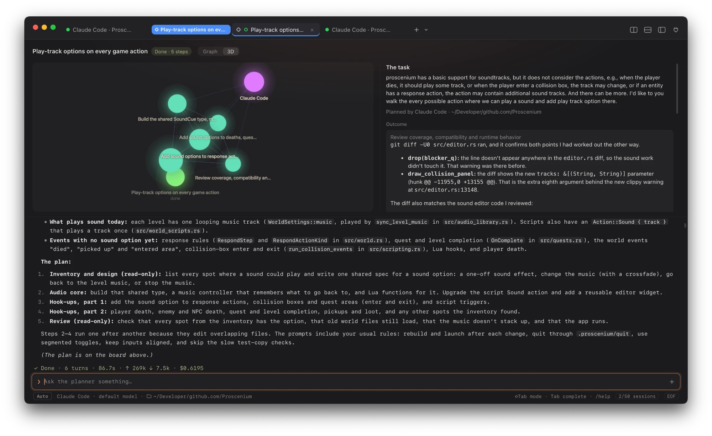

<p align="center">
  
</p>

<p align="center">
  <a href="LICENSE"></a>
  <a href="https://github.com/reevik/Paw/releases/latest"></a>
</p>

<h1 align="center">Agentic Terminal Multiplexer</h1>

<p align="center">
  
</p>

## Main features

- **Many agents, one window.** Run Claude Code, Codex CLI, Gemini CLI, Copilot CLI, Cursor Agent, opencode, Aider, Qwen Code and Goose side by side, in tabs, split panes and tab groups you can fold and drag.
- **Paw Agent.** A built-in agent on your own models: Anthropic, GitHub Copilot, ChatGPT, OpenRouter, Ollama or any OpenAI-compatible provider.
- **Tasks.** Describe a goal; a planner splits it into steps for your agents, runs them in order or side by side, and shows the plan as a graph (or in 3D). Steps that need you wait for your approval.
- **Factories.** Pipelines of agents you describe once in a YAML file, started by a schedule, a watched command, a webhook or a file change. See [Factories](#factories) below.
- **A shell in every tab.** Run commands next to the agent in your own shell, then pass their output to the agent with one click.
- **Keeps running.** Agents run in a background process with a menu bar icon, so closing the window doesn't stop their work.
- **Sessions.** Each session's conversation, scripts and files are kept in `~/.paw`; reopen past sessions and see your usage per day, week and month.
- **Plugins.** Extend Paw with commands, status bar items and task board views, from the [official catalog](plugins) or your own.
- **Your look.** Themes for light and dark, and your choice of font and size.

## Factories

<p align="center">
  
</p>

A factory is a pipeline of agents that Paw runs in the background, so it keeps going while the window is closed. You describe it once in `~/.paw/factories/<name>.yaml`, or ask Paw Agent to write it:

```yaml
name: Create Release
folder: ~/Developer/my-app
trigger:
  watch: ./new-commit.sh     # a run for each new commit
  every: 30s
  fires: each
nodes:
  - id: bump
    title: Bump the version and update the changelog
    prompt: Bump the minor version, add a changelog entry for the new commit, and commit it.
  - id: publish
    title: Push to origin
    needs: [bump]
    tools: [shell]
    prompt: Push the current branch to origin.
```

- **Any shape:** nodes run in order or side by side; they can join (`join: all` or `any`), branch (`when` an earlier answer matches) and wait (`wait` until a command succeeds).
- **Each node its own agent:** its model, skills, built-in tools and MCP servers.
- **Started on their own:** `every`, `at` (times of day), `watch` (a command), `webhook` (`POST 127.0.0.1:4747/factories/<id>`, its body going to the nodes) and `file`. `repeat` loops a pipeline.
- **Watched like a task:** the graph shows each node's state (failed ones glow red, waiting ones amber), a click shows a node's task and activity, and the timeline shows where the time went. Approvals wait in the view until you answer them.

The full format is in [docs/factories.md](docs/factories.md).

