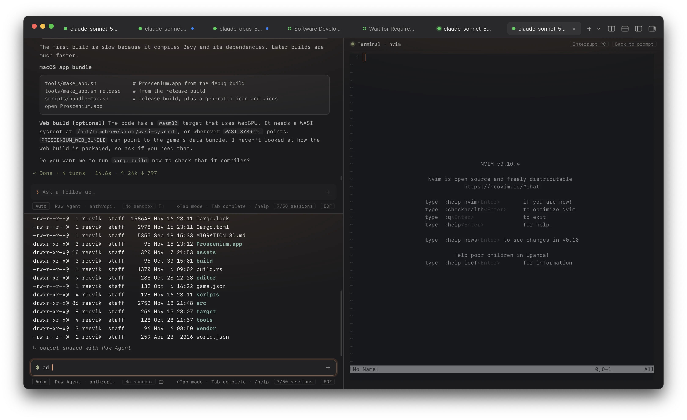
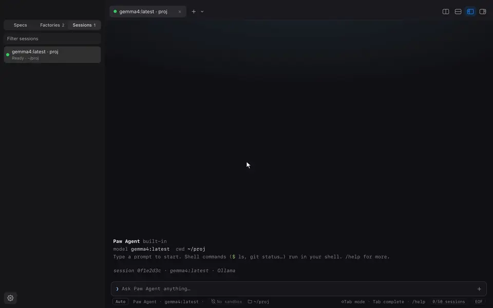
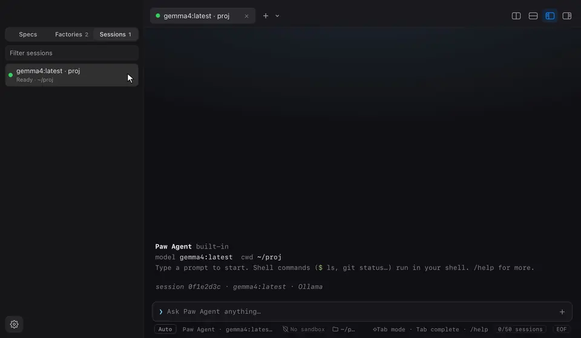
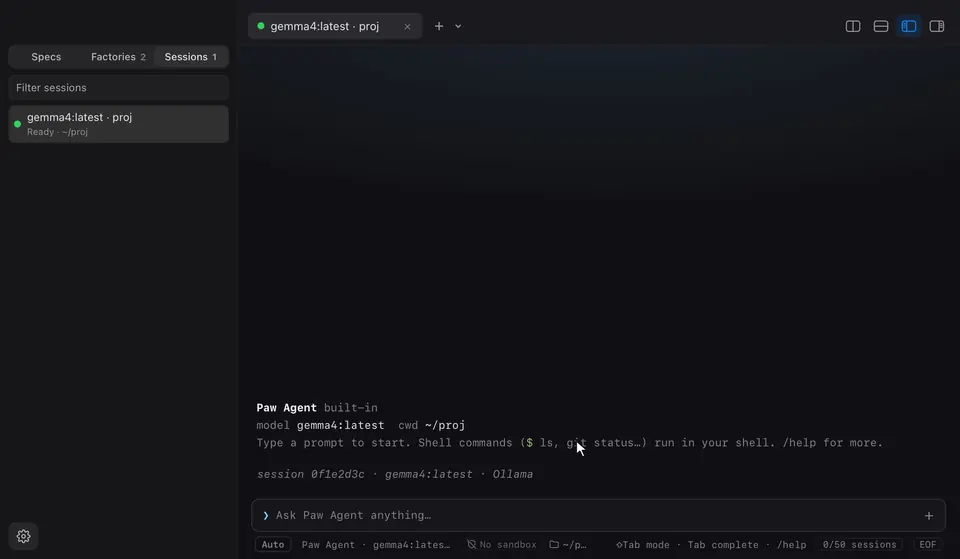
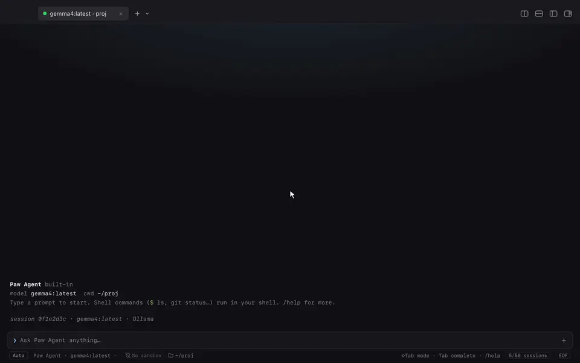
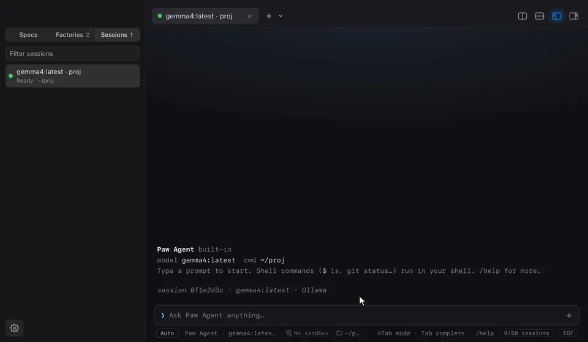
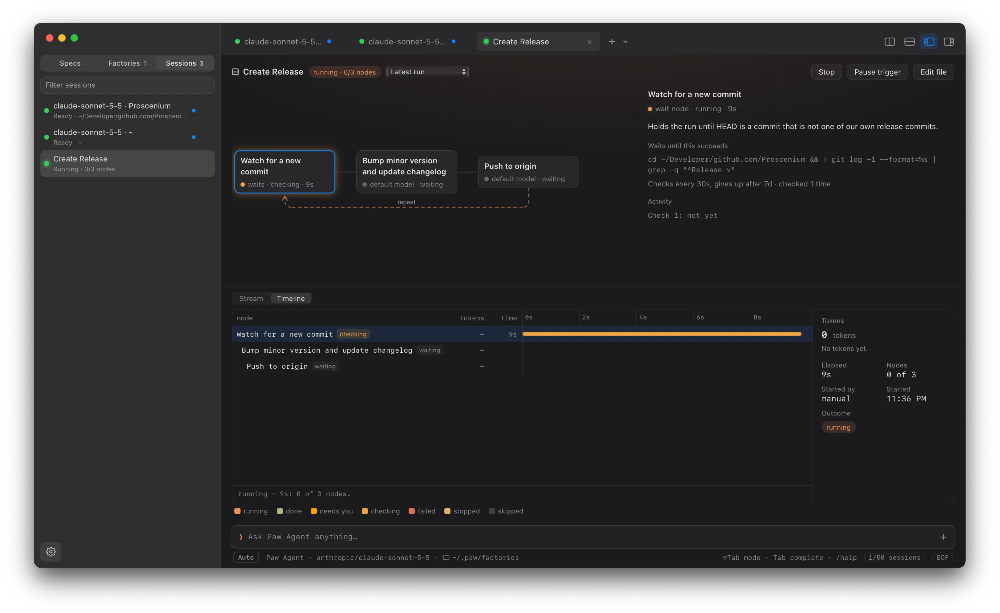

<p align="center">
  
</p>

<p align="center">
  <a href="LICENSE"></a>
  <a href="https://github.com/reevik/Paw/releases/latest"></a>
</p>

<h1 align="center">Agentic Terminal Multiplexer</h1>
<p align="center">
     One terminal, to rule them all... 
</p>


<p align="center">
  
</p>


## What is Paw? 

Paw is a terminal multiplexer built for working with agents. Jump between an agent and your shell without missing a beat.


## Main features

- **Tabs and split panes.** Every tab is a session with its own agent, model and shell. Split side by side (⌘D) or stacked (⌘⇧D), switch tabs within a pane, and keep related tabs in groups.

  

- **Paw Agent.** A built-in agent on your own models: Anthropic, GitHub Copilot, ChatGPT, OpenRouter, Ollama or any OpenAI-compatible provider.
- **Plans.** Describe a goal with `/plan`; a planner splits it into steps for your agents, you review the plan, and it runs them in order or side by side, shown as a graph (or in 3D). Steps that need you wait for your approval.

  

- **Factories.** Pipelines of agents you describe once in a YAML file, started by a schedule, a watched command, a webhook or a file change. See [Factories](#factories) below.

  

- **A shell in every tab.** Run commands next to the agent in your own shell, then pass their output to the agent with one click.

  

- **Keeps running.** Agents run in a background process with a menu bar icon, so closing or quitting the window doesn't stop their work. Open Paw again and each tab re-attaches to its agent and shell, with what happened meanwhile.

  

- **Sessions.** Each session's conversation, scripts and files are kept in `~/.paw`. `/sessions` (or the count in the status bar) lists them; a completed one reopens in a new tab and its conversation carries on. `/stats` shows your usage per day, week and month.

  

- **Fork a conversation.** **Fork Tab** (the tab's menu, File, or `/fork`) opens a new tab that goes on from a tab's conversation, so you can try another way without losing the first.

  

- **Plugins.** Extend Paw with commands, status bar items and plan board views, from the [official catalog](plugins) or your own.
- **Sandbox.** Paw Agent can work in macOS's sandbox: changes only in its project folder, only the programs you allow, and the network only if you let it. See [Sandbox](docs/sandbox.md).

  

- **Your look and language.** Themes for light and dark, your choice of font and size, and Paw in English, German or Turkish; Paw Agent answers in the language you pick.
- **Your keys.** Change Paw's shortcuts in **Settings › Keys**: click one and press the new keys. A key that's already taken (by another shortcut or by macOS) is turned down, with what uses it.

## Factories

<p align="center">
  
</p>

A factory is a pipeline of agents that Paw runs in the background, so it keeps going while the window is closed. You describe it once in `~/.paw/factories/<name>.yaml`, or ask Paw Agent to write it:

```yaml
name: Create Release
folder: ~/Developer/my-app
trigger:
  watch: ./new-commit.sh     # a run for each new commit
  every: 30s
  fires: each
nodes:
  - id: bump
    title: Bump the version and update the changelog
    prompt: Bump the minor version, add a changelog entry for the new commit, and commit it.
  - id: publish
    title: Push to origin
    needs: [bump]
    tools: [shell]
    prompt: Push the current branch to origin.
```

- **Any shape:** nodes run in order or side by side; they can join (`join: all` or `any`), branch (`when` an earlier answer matches) and wait (`wait` until a command succeeds).
- **Each node its own agent:** its model, skills, built-in tools and MCP servers.
- **Started on their own:** `every`, `at` (times of day), `watch` (a command), `webhook` (`POST 127.0.0.1:4747/factories/<id>`, its body going to the nodes) and `file`. `repeat` loops a pipeline.
- **Side by side:** every run has its own execution id (a UUID) and folder, `~/.paw/factories/<id>/<execution-id>/`. Runs of one factory can go at once, each in its own project folder and with its own task.
- **Started from a chat:** ask Paw Agent to run a factory on the project at hand; it starts the run once you confirm, and tells you how it's going.
- **They ask you:** a node can ask a question or wait for you to approve its answer, with a notification; answer in the view or in the node's own session.
- **Watched like a plan:** the graph shows each node's state (failed ones glow red, waiting ones amber), a click shows a node's task and activity, and the timeline shows where the time went. Approvals wait in the view until you answer them.
- **Laid out by hand:** unlock the graph to move its boxes and route its lines: select a line, add elbow points with its + handles, drag a stretch to move it, and undo with ⌘Z.

  


The full format is in [docs/factories.md](docs/factories.md).

